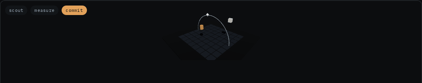
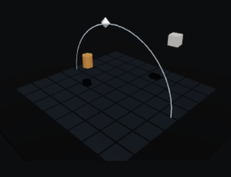
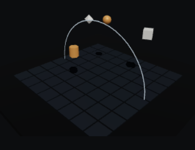
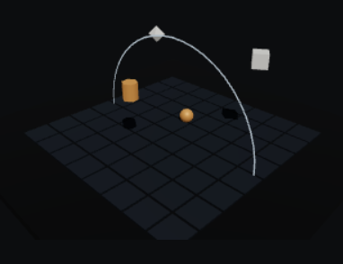
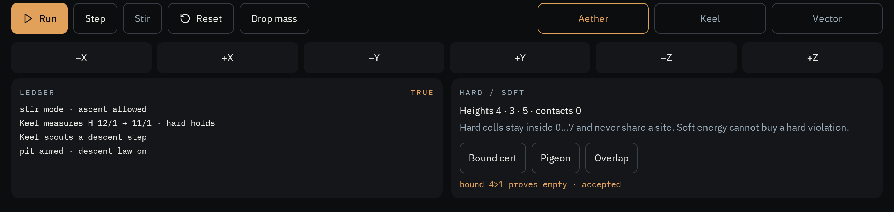
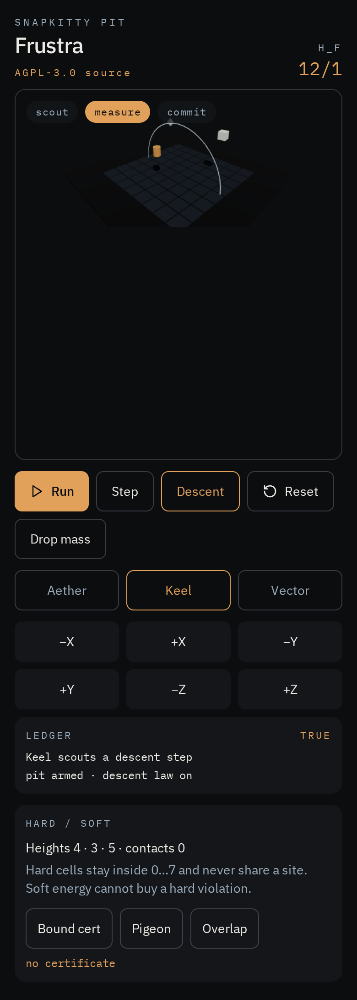
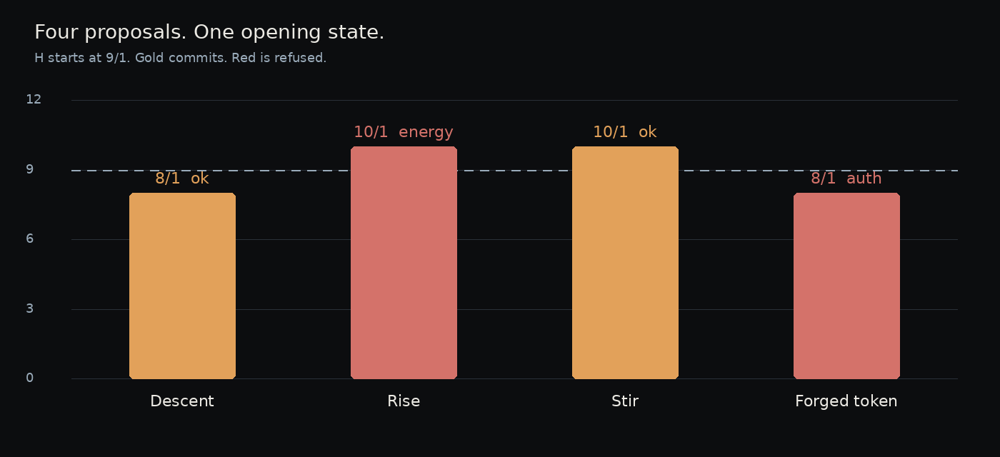

<p align="center">
  
</p>

<h1 align="center">Frustration Hamiltonian</h1>

<p align="center">
  Exact rational commit law for three agents in a closed box.<br>
  Height is potential. Contact costs. Overlap is not a bargain.
</p>

<p align="center">
  
</p>

<p align="center"><sub>Scout. Measure. Commit.</sub></p>

<table>
  <tr>
    <td align="center" width="33%">
      <br>
      <sub>Measure</sub>
    </td>
    <td align="center" width="33%">
      <br>
      <sub>Mass in flight</sub>
    </td>
    <td align="center" width="33%">
      <br>
      <sub>Stir</sub>
    </td>
  </tr>
</table>

<p align="center">
  
</p>

<p align="center"><sub>Six axes. The ledger. Bound, pigeon, and forced overlap.</sub></p>

<p align="center">
  
</p>

<p align="center"><sub>The same instrument, one column wide.</sub></p>

---

Aether, Keel, and Vector live on an 8×8×8 lattice.

```
H_F(s) = y₀ + y₁ + y₂ + C₀₁ + C₀₂ + C₁₂
```

`Cᵢⱼ` is 1 only when the Manhattan distance is exactly 1.

A commit requires a hard-valid cell, an authorized actor, and a verified unit step of at most one body. With descent on, `H` may not rise. A better soft value never buys a shared cell. Overflow rejects. It does not wrap.

## Opening

Generation 5. No contacts. `H_F = 9/1`.

| Agent | x | y | z | Share of the bill |
| --- | ---: | ---: | ---: | ---: |
| Aether | 0 | 3 | 0 | 3 |
| Keel | 2 | 2 | 0 | 2 |
| Vector | 4 | 4 | 1 | 4 |
| C₀₁ + C₀₂ + C₁₂ | | | | 0 |

## The same four proposals

<p align="center">
  
</p>

| Case | What is proposed | H | Commit | Code |
| --- | --- | --- | --- | --- |
| Descent | Aether, y − 1 | 9/1 → 8/1 | TRUE | ok |
| Rise | Aether, y + 1 | 9/1 → 10/1 | FALSE | energy |
| Stir | the same rise, descent off | 9/1 → 10/1 | TRUE | ok |
| Forged token | the descent step, token `1` | 9/1 → 8/1 | FALSE | auth |
| Shared cell | Aether and Keel occupy one site | not the reason | FALSE | hard |
| Broken rational | `1/0` | — | FALSE | denom |

`make demo` exits 0 only when every row matches.

## Order of refusal

The kernel does not shop for a kinder answer. First failure wins.

| | Gate | Code |
| --- | --- | --- |
| 1 | Actor is 0, 1, or 2 | index |
| 2 | Generation is unchanged | malformed |
| 3 | Destination is inside the box and unshared | hard |
| 4 | Token, mask, and the mover is the actor | auth |
| 5 | At most one body, one axis, one cell | verify |
| 6 | If descent is on, `H` did not rise | energy |
| 7 | Generation is not saturated | overflow |

## Standing

Lean 4.21.0. No Mathlib. No `sorry`.

| Claim | Standing |
| --- | --- |
| A commit leaves a hard-valid state | Proved in Lean |
| Descent does not increase `H` | Proved in Lean |
| An unauthorized move cannot commit | Proved in Lean |
| Zero denominator is rejected; the gcd cancels | Proved in Lean |
| Empty interval, pigeonhole, forced overlap | Proved in Lean |
| C kernel on the same examples, including limb overflow | Tested |
| Modula-2 rationals and the host call into C | Tested |
| GLPK `feasible.mod` | Tested. `INTEGER OPTIMAL`, `H = 0` |
| GLPK `infeasible.mod` | Tested. No primal feasible solution |
| The C is the Lean | Unverified |
| `kernel.s` is CompCert | Unverified. It is `gcc -S` |
| Limb overflow, inside Lean | Unverified. Lean `Int` does not wrap |

The long form is [fh/STATUS.md](fh/STATUS.md).

```
cd fh
make demo
make test
```

| Path | |
| --- | --- |
| `fh/c` | C kernel, host FFI, `demo.c` |
| `fh/lean` | Proofs |
| `fh/m2` | Modula-2 exact rationals, and the call into C |
| `fh/ampl` | One feasible model, one empty model |
| `fh/asm` | `gcc -S` listing. Not a semantics proof |


## License

Copyright (C) 2026 AHMAD ALI PARR

The kernel, the proofs, and the models are [GNU AGPL v3 or later](LICENSE) (`AGPL-3.0-or-later`).
