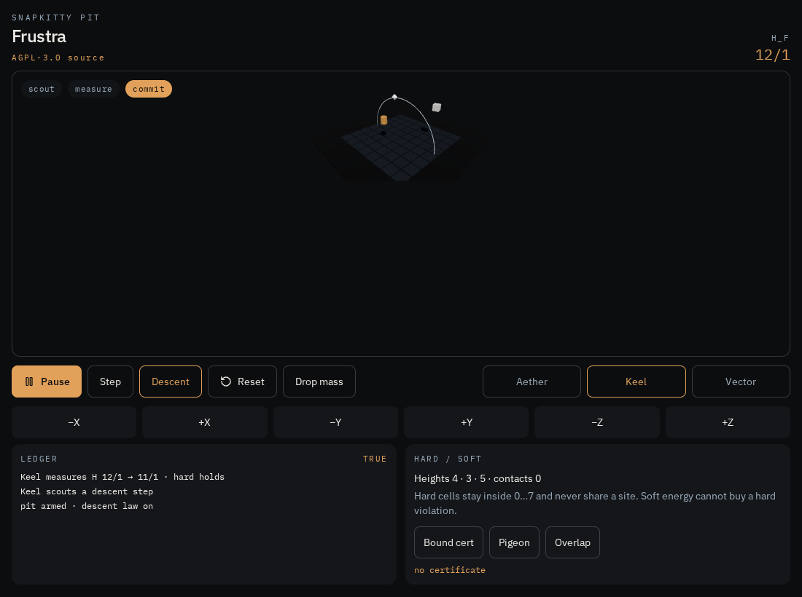
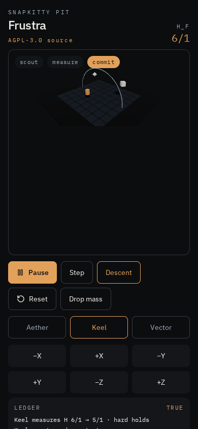

# Frustration Hamiltonian

<p align="center">
  
</p>

<p align="center">
  
</p>

Three bodies in a closed box. They want to fall. The law will not let them cheat.

<p align="center">
  
</p>

<p align="center">
  
  
</p>

Aether, Keel, and Vector occupy an 8×8×8 lattice. Height is potential. Standing one cell apart is contact, and contact costs.

```
H_F(s) = y₀ + y₁ + y₂ + C₀₁ + C₀₂ + C₁₂
```

`Cᵢⱼ` is 1 only when the Manhattan distance is exactly 1.

A proposed next state commits only when the destination is hard-valid, the token authorizes the actor, at most one agent took a unit step, and — if descent is on — `H` did not rise. Overlap is not a bargain. Overflow rejects. It does not wrap.

## What is actually certified

Lean 4.21.0, no Mathlib and no `sorry`, proves the commit law, rational normalization, and the emptiness certificates. The C kernel and the Modula-2 rationals are tested on the same examples. GLPK shows one model feasible and one empty.

Not certified, and not pretended: there is no proof the C matches the Lean, and `kernel.s` is `gcc -S`, not CompCert. The ledger is [fh/STATUS.md](fh/STATUS.md).

```
cd fh
make demo
make test
```

`make demo` exits 0 only when the descent, the refused rise, stir, the overlap, the bad token, and a zero denominator all match.

| Path | What it is |
| --- | --- |
| `fh/c` | The C kernel, the host FFI, and `demo.c` |
| `fh/lean` | The proofs |
| `fh/m2` | Modula-2 exact rationals and the call into C |
| `fh/ampl` | One feasible model, one empty model |
| `fh/asm` | The `gcc -S` listing. Not a semantics proof |

## License

Copyright (C) 2026 AHMAD ALI PARR

The kernel, the proofs, and the models are [GNU AGPL v3 or later](LICENSE) (`AGPL-3.0-or-later`).
