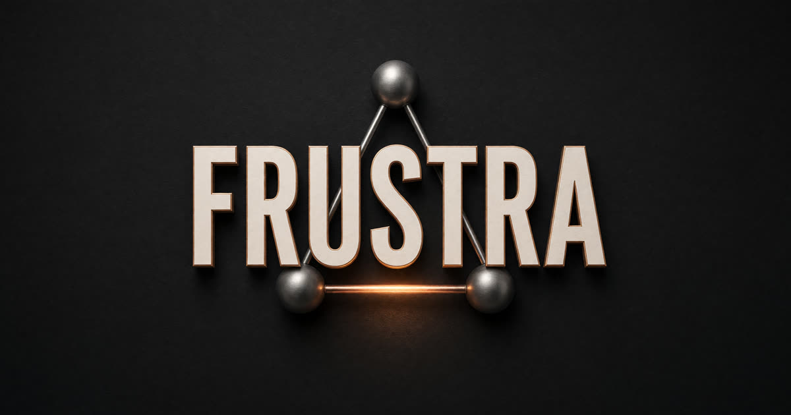

# Frustration Hamiltonian

<p align="center">
  
</p>

Three bodies in a closed box. They want to fall. The law will not let them cheat.

Aether, Keel, and Vector occupy an 8×8×8 lattice. Height is potential. Standing one cell apart is contact, and contact costs. The bill is

```
H_F(s) = y₀ + y₁ + y₂ + C₀₁ + C₀₂ + C₁₂
```

`Cᵢⱼ` is 1 only when the Manhattan distance is exactly 1.

A proposed next state commits only when all of this is true:

- the destination is hard-valid (inside the box, no shared cell)
- the token, actor, and generation authorize the move
- at most one agent took a single-axis unit step
- if descent is on, `H` did not increase

Overlap is not a bargain. A lower soft value never buys a hard failure. Arithmetic is exact and rational. Overflow rejects. It does not wrap.

## What is actually certified

Lean 4.21.0, no Mathlib and no `sorry`, proves the commit law, rational normalization, and the emptiness certificates (bound, pigeon, forced overlap). The C kernel and the Modula-2 rationals are tested against the same examples. GLPK agrees the separation model is feasible in one case and empty in the other.

What is not certified, and will not be pretended:

- There is no machine-checked proof that the C matches the Lean.
- `kernel.s` is `gcc -S`. CompCert is not in this tree.

The blunt ledger is [fh/STATUS.md](fh/STATUS.md).

## Run it

```
cd fh
make demo
make test
```

`make demo` prints the descent, the refused rise, stir, the overlap, the bad token, and a zero denominator. It exits 0 only when each one matches.

Full rebuild, when the compilers exist: `gcc`, GNU Modula-2 (`gm2`, GCC 12), `glpsol` 5, Lean `v4.21.0`.

```
cd fh
make test test-compile-fail test-link-fail asm m2 host
glpsol --math ampl/feasible.mod
glpsol --math ampl/infeasible.mod
cd lean && lake build
```

| Path | What it is |
| --- | --- |
| `fh/c` | The C kernel, the host FFI, and `demo.c` |
| `fh/lean` | The proofs |
| `fh/m2` | Modula-2 exact rationals and the call into C |
| `fh/ampl` | One feasible model, one empty model |
| `fh/asm` | The `gcc -S` listing. Not a semantics proof |

## License

Copyright (C) 2026 AHMAD ALI PARR

The kernel, the proofs, and the models are [GNU AGPL v3 or later](LICENSE) (`AGPL-3.0-or-later`).
